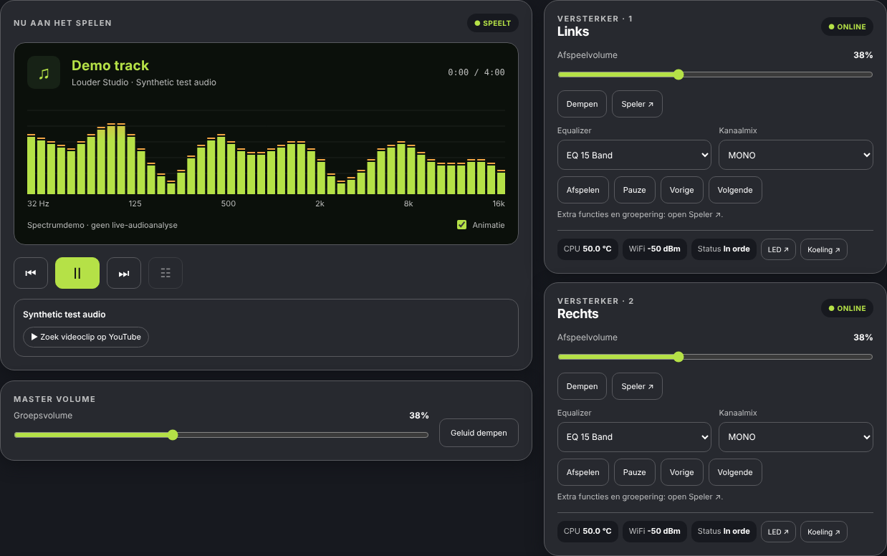
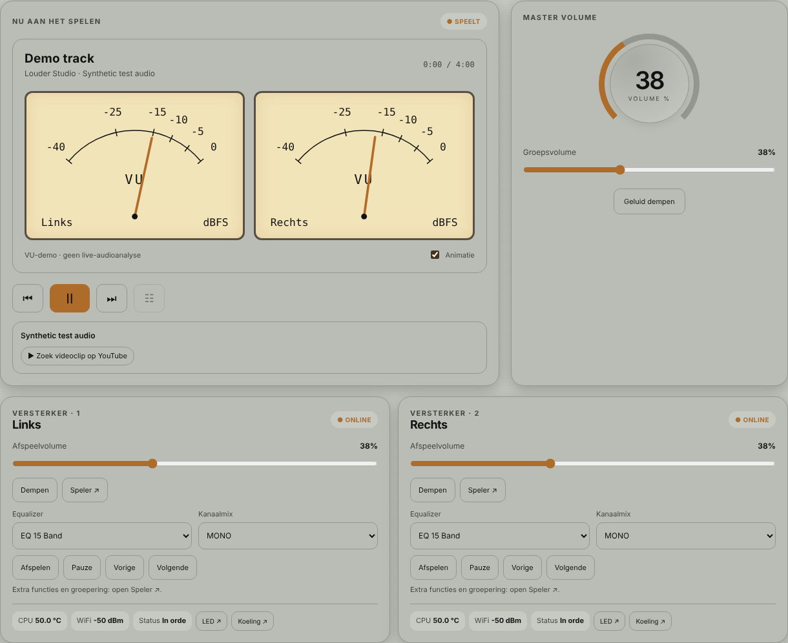
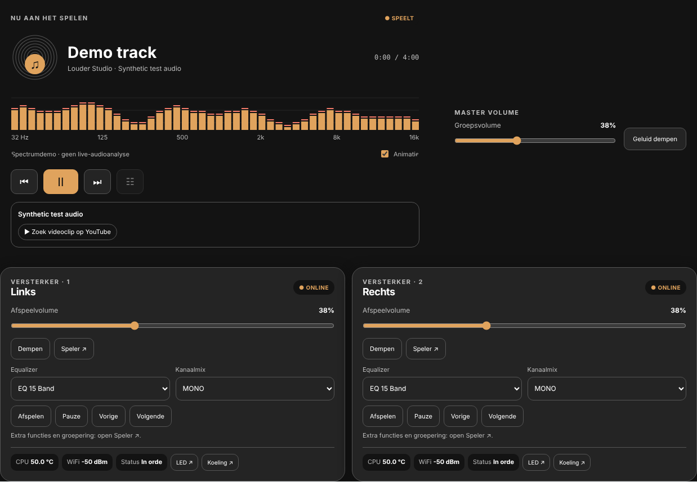
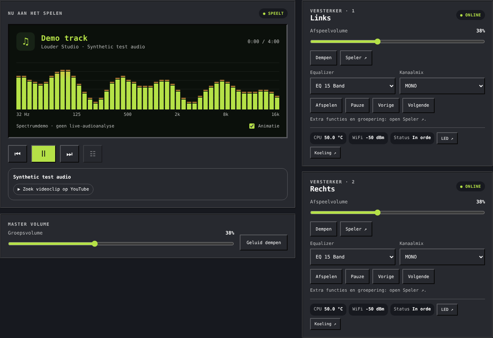
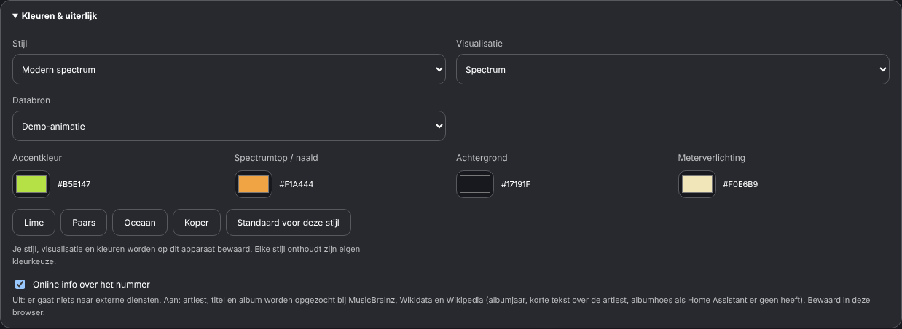
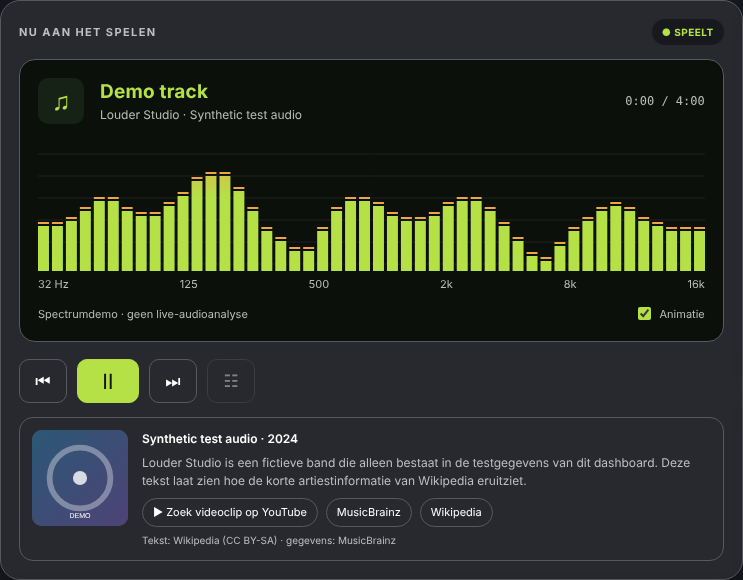
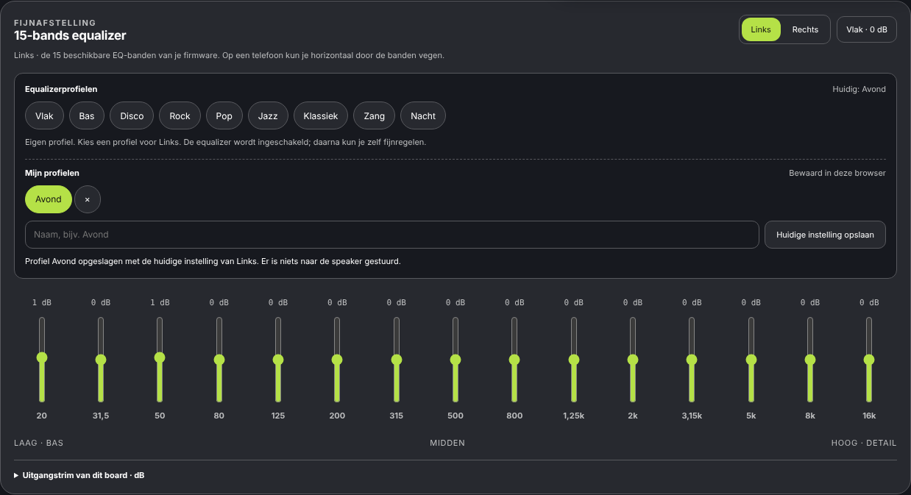

# Multiroom Audio Dashboard

Home Assistant-audiobediening met vier instelbare stijlen, spectrum of analoge bronmeters, eigen kleuren en optionele equalizerbediening. Voorheen Louder Studio Card.

**Status: 2.2.0-beta.7.** Automatisch getest met fictieve HA-statussen en PCM-audio. Praktijktests per speaker/integratie staan nog open. GitHub kan geen apparaten bij jou thuis testen. Deze repository installeert niets automatisch in Home Assistant.

Snel naar: [Kleuren en stijl](#waar-stel-ik-dit-in) · [Andere speakers kiezen](#andere-slimme-speakers-toevoegen) · [Installeren via de Marketplace](#installeren-via-de-marketplace).

## Zo ziet het eruit

De beelden hieronder zijn screenshots van de werkende kaart met fictieve spelers en demo-audio. Ze tonen het uiterlijk; de bewegende meters zie je in Home Assistant. Iedere stijl kan een spectrum of analoge meters gebruiken en heeft eigen instelbare kleuren.

### Modern spectrum



### Vintage hifi



### Midnight studio



### Retro spectrum



## Waar stel ik dit in?

**De instellingen zitten in de dashboardkaart zelf. Via Instellingen → Marketplace (voorheen HACS) installeer en update je de kaart.**

1. Open je bestaande Home Assistant-dashboard met deze kaart.
2. Klap **Kleuren & uiterlijk** uit, direct onder de titel.
3. Kies de **Stijl**, **Visualisatie** (spectrum of analoge VU-meters) en **Databron** (Live Music Assistant of Demo).
4. Stel **Accentkleur**, **Spectrumtop / naald**, **Achtergrond** en **Meterverlichting** in, of kies een kleurcombinatie.
5. Optioneel: zet **Online info over het nummer** aan (zie [Wat er speelt](#wat-er-speelt-albumhoes-en-info)).



De voorkeuren worden direct in deze browser bewaard; iedere stijl onthoudt zijn eigen kleuren. Je hoeft hiervoor geen YAML aan te passen. EQ-profielen en schuiven staan verder naar beneden en verschijnen alleen bij een daarvoor geconfigureerde versterker.

### Wat er speelt: albumhoes en info

Vanaf **2.2.0-beta.5** toont de kaart onder **Nu aan het spelen** de albumhoes en een knop **▶ Zoek videoclip op YouTube**.



*Voorbeeld met fictieve gegevens en online info aan. Met online info uit zie je alleen titel, albumhoes en de YouTube-knop.*

- Titel, artiest en album komen van de hoofdspeler. Meldt die niets (bijvoorbeeld een groep), dan van de speaker die speelt.
- Sendspin-spelers (zoals de Louder-ESP32 met Sendspin-firmware) geven de titel niet via de mediaspeler door, maar via de sensoren **Track Title**, **Artist** en **Album** van hetzelfde apparaat. Vanaf **2.2.0-beta.7** gebruikt de kaart die automatisch. Een albumhoes geven deze sensoren niet; die komt dan alleen via online info (Cover Art Archive).
- De albumhoes komt uit Home Assistant (zoals Music Assistant die aanlevert). Daarvoor gaat niets naar externe diensten.
- De YouTube-knop opent alleen een zoekopdracht in een nieuw tabblad als je erop klikt.

**Online info (optioneel, standaard uit):** zet onder **Kleuren & uiterlijk** het vinkje **Online info over het nummer** aan. Dan zoekt de kaart artiest, titel en album op bij MusicBrainz, Wikidata en Wikipedia en toont het jaar, een korte tekst over de artiest (Nederlands, anders Engels) en zo nodig een albumhoes van het Cover Art Archive. Met het vinkje uit gaat er niets naar die diensten. De instelling wordt per browser bewaard. Songteksten worden niet getoond (auteursrecht).

### Eigen equalizerprofielen opslaan

Vanaf **2.2.0-beta.4** kun je een eigen EQ-instelling bewaren onder een naam:



1. Kies in de equalizer het board (bijvoorbeeld **Links**) en zet de schuiven zoals je wilt.
2. Typ onder **Mijn profielen** een naam, bijvoorbeeld *Avond*, en klik op **Huidige instelling opslaan** (of druk op Enter).
3. Je profiel verschijnt als knop. Klik erop om het later weer toe te passen, op hetzelfde of een ander board met 15 banden.

- Opslaan leest alleen de huidige stand; er wordt niets naar de speaker gestuurd.
- Dezelfde naam nog eens opslaan werkt het profiel bij. Namen van standaardprofielen (Bas, Disco, …) zijn niet toegestaan. Maximaal 24 profielen, namen tot 40 tekens.
- Verwijderen: klik op **×** en daarna binnen 5 seconden op **Verwijderen?**.
- De profielen worden bewaard in je **Home Assistant-gebruikersaccount** (in het lokale voorbeeld hierboven: in de browser), dus ze zijn er ook op je telefoon of tablet als je met dezelfde HA-gebruiker inlogt. Een andere HA-gebruiker (bijvoorbeeld een wandtablet met een eigen account) ziet ze niet.

### Andere slimme speakers toevoegen

De Marketplace zoekt geen speakers op je netwerk. Voeg een speaker eerst via zijn passende integratie toe aan Home Assistant, zodat hij daar als `media_player` beschikbaar is.

Vanaf **2.2.0-beta.3** kun je zonder YAML spelers kiezen:


1. Klik bovenaan de audiokaart op de opvallende knop **⚙ Speakers beheren**. Dashboard-bewerkmodus is niet nodig.
2. De Home Assistant-kaarteditor opent. Je ziet de beschikbare HA-spelers, inclusief bestaande spelers die tijdelijk niet beschikbaar zijn. Zoek op naam en vink de gewenste speakers aan.
3. Kies de **Hoofdspeler** of bestaande groep voor het bovenste afspeelpaneel.
4. Klik op **Opslaan** in de Home Assistant-kaarteditor. Met Annuleren blijft de selectie ongewijzigd.

De knop is beschikbaar voor een HA-beheerder. Hij opent alleen de editor: er worden geen dashboardgegevens of apparaatopdrachten verstuurd totdat je zelf een wijziging opslaat of een apparaat bedient. Bij oudere/afwijkende dashboardlayouts blijft de standaardroute beschikbaar: Dashboard bewerken → **Edit / Bewerken onder de hele kaart**. In een schermvullende panelweergave staat die standaardknop helemaal onderaan, voorbij de equalizer.


Vanaf **2.2.0-beta.6** zoekt de kaart bij een gekozen speaker zelf de bijbehorende versterkerbediening op: de 15 EQ-banden, EQ-modus, kanaalmix, uitgangstrims, CPU-temperatuur, WiFi, storingsmelding, led en ventilator. Dat gebeurt via het **apparaat** van de speaker in Home Assistant (alleen entiteiten van datzelfde apparaat, met de namen die de Sonocotta ESPHome-firmware maakt). Je hoeft dus geen EQ-entiteiten meer in YAML te zetten, en na het **hernoemen** van een speaker vindt de kaart de nieuwe namen vanzelf.

- Zelf ingestelde entiteiten in de kaartconfiguratie gaan voor, zolang ze bestaan. Een verouderde naam (bijvoorbeeld na hernoemen) wordt vervangen door wat bij het apparaat hoort.
- Uitzetten kan met `auto_entities: false` in de kaartconfiguratie.
- Er worden geen luidsprekers automatisch gegroepeerd.

Zie je **Kleuren & uiterlijk** niet? Controleer of het dashboard de Marketplace-resource laadt en herlaad de browser volledig. Volg hieronder de stappen voor een bestaande installatie; je hoeft je dashboard niet opnieuw te maken.

## Installeren via de Marketplace

Sinds Home Assistant **2026.11** is HACS ingebouwd als **Marketplace**. Alleen een beheerder kan die openen.

1. Ga naar **Instellingen → Marketplace**. Accepteer de eerste keer de waarschuwing over community-inhoud.
2. Kies rechtsboven **Add from link** (toevoegen via link) en vul `tlpeter/multiroom-audio-dashboard` in. De Marketplace vraagt je zo nodig eerst GitHub te koppelen. Kies als type een dashboardkaart als daarom gevraagd wordt.
3. Open **Multiroom Audio Dashboard** in de lijst en kies **Install**. Controleer de versie en kies nogmaals **Install**.
4. **Beta-versies:** standaard biedt de Marketplace alleen stabiele versies. Wil je een beta zoals deze, ga dan naar **Instellingen → Apparaten & diensten → Marketplace**, open het apparaat **Multiroom Audio Dashboard**, schakel de entiteit **Pre-release** in en zet de schakelaar aan. Een andere versie kiezen kan ook via ⋮ → **Install another version**.
5. De kaart wordt geïnstalleerd in `www/community/` en als resource toegevoegd: `/local/community/multiroom-audio-dashboard/louder-amplifier-card.js` (JavaScript-module). Beheer je resources in YAML, voeg die regel dan zelf toe; het installatievenster toont hem. Herlaad daarna de browser volledig.
6. Voeg een kaart toe met je eigen spelers, of kies ze later met **⚙ Speakers beheren**:

```yaml
type: custom:multiroom-audio-dashboard
entity: media_player.woonkamer
players:
  - player: media_player.woonkamer
    name: Woonkamer
  - player: media_player.keuken
    name: Keuken
```

`entity` is de expliciete hoofdspeler of bestaande groep. `players` bevat 1–32 individuele spelers. Zonder `players` toont de kaart alleen de hoofdspeler. De kaart maakt zelf geen groep en verandert geen volume of afspeelstatus bij openen.

**Updates** verschijnen onder **Instellingen → Updates**. De Marketplace controleert eigen repositories ongeveer elke 48 uur (met gekoppelde GitHub). Herlaad na een update de browser.

**Bestaande installatie van vóór 2026.11:** je HACS-installatie, eigen repositories en update-entiteiten zijn automatisch meegenomen naar de Marketplace. De oude resource `/hacsfiles/multiroom-audio-dashboard/louder-amplifier-card.js` blijft werken. Laad maar **één versie** van het JavaScript: verwijder een oude inline/lokale resource als je die nog hebt. Je oude `custom:louder-amplifier-card`-type, `boards`-configuratie en stijlvoorkeuren blijven werken; de oude bestandsnaam is behouden voor compatibiliteit.

**Oudere Home Assistant (vóór 2026.11):** voeg de repository in HACS toe via menu → **Aangepaste repositories**, type **Dashboard**, en installeer daar.

Zonder Marketplace: plaats het releasebestand `louder-amplifier-card.js` in `/config/www/multiroom-audio-dashboard/`, registreer `/local/multiroom-audio-dashboard/louder-amplifier-card.js?v=2.2.0-beta.7` als module en herlaad. Een HA-herstart is niet nodig voor deze frontendresource.

## Uiterlijk en bediening

- Modern spectrum, Retro spectrum, Vintage hifi en Midnight studio; analoge meters of spectrum onafhankelijk van de stijl.
- Accent, spectrumtop/naald, achtergrond en meterverlichting. Iedere stijl onthoudt zijn eigen kleurkeuze per browser.
- Afspelen/pauze/stop, vorige/volgende, volume, mute, volumestappen, aan/uit, bron, native geluidsprofiel, positie, shuffle en herhalen, uitsluitend wanneer de HA-speler de functie aanbiedt.
- **Speler ↗** opent de native HA-bediening voor overige functies en groepering, voor zover de integratie die aanbiedt.
- Optionele ESPHome-instellingen: mixer, uitgangstrims, sensoren en 15-bands EQ. Profielen: Vlak, Bas, Disco, Rock, Pop, Jazz, Klassiek, Zang en Nacht, plus je eigen profielen met een naam (zie hieronder). [Voorbeeldconfiguratie](examples/card.json).

Een speaker met een bassregelaar heeft niet automatisch een 15-bands EQ. Zie de [ondersteunings- en testmatrix](docs/SPEAKER_SUPPORT.md) voor alle speakerfamilies en openstaande praktijktests.

## Echte bronmeters en demo

**Live Music Assistant** leest waveformdata via MilkDrop en de bestaande, same-origin HA-ingressverbinding. Er zijn geen ingebouwde toegangstokens. De browser speelt zelf geen audio af.

De meters tonen RMS van het gemengde **mono-bronsignaal**, vóór speaker-DSP. Beide naalden tonen dezelfde bron. Het zijn geen afzonderlijke metingen van fysieke linker/rechter uitgangen. De schaal is dBFS met 300 ms niveaudemping en gedempte naaldbeweging. Het spectrum gebruikt FFT met relatieve frequenties, omdat het relayprotocol geen samplefrequentie meestuurt.

Bij ontbrekende of verouderde data stoppen de meters. Er is geen automatische demo-fallback. **Demo-animatie** is expliciet te kiezen en wordt als demo aangeduid. Een gewone HA-speaker zonder MA-waveformbron heeft wel bediening, maar geen echte bronmeters.

Live verwacht een `music_assistant`-media_player, de Music Assistant-app (`d5369777_music_assistant`) en de MilkDrop Visualizer-plugin. Andere installatieroutes zijn nog niet gevalideerd. Geen token in de configuratie plakken.

## Ontwikkeling, testen en beveiliging

`dev` bevat testversies; `main` de versie voor release. Issues hebben dezelfde labels als Smart Charging Planner, met formulieren voor bugs, functies en echte hardwaretests. Releases verschijnen alleen na een geslaagde Tests-workflow op hetzelfde main-commit. Beta's blijven herkenbaar als prerelease.

```sh
npm ci --ignore-scripts
npm test
npx playwright install chromium
npm run test:browser
```

GitHub Actions controleert Node 22/24, Chromium desktop/mobiel, EQ, kleuren, live bronmeters en generieke capabilities. CodeQL, npm audit en Gitleaks draaien mee als releasevoorwaarde. Dependabot controleert npm en Actions. Geheimmeldingen, pushbeveiliging en automatische beveiligingsupdates zijn op GitHub ingeschakeld. Zie [testplan](tests/TESTPLAN.md), [beveiliging](SECURITY.md) en [changelog](CHANGELOG.md).

Lokaal voorbeeld: `npm run preview`, daarna `http://127.0.0.1:18905`. Het voorbeeld gebruikt fictieve gegevens en stuurt geen opdrachten naar apparaten. De previewserver luistert uitsluitend lokaal.

## Naam en bronnen

De neutrale naam beschrijft het project. Dit is geen officieel product van een speakerfabrikant. [Naamonderzoek en beperkingen](docs/NAME_REVIEW.md): bestaand Louder-gebruik is gevonden; volledige juridische merkenvrijgave is niet uitgevoerd.

- [HA media-playercontract](https://developers.home-assistant.io/docs/core/entity/media-player/)
- [Music Assistant MilkDrop](https://www.music-assistant.io/plugins/milkdrop-visualizer/)
- [Relayprotocol MA 2.10.8](https://github.com/music-assistant/server/blob/2.10.8/music_assistant/providers/milkdrop_visualizer/relay.py)
- [Audioverwerking](https://github.com/music-assistant/server/blob/2.10.8/music_assistant/providers/milkdrop_visualizer/tap.py)
- [HA-ingress](https://github.com/home-assistant/frontend/blob/20260930.5/src/data/hassio/ingress.ts)
- [Home Assistant Marketplace](https://www.home-assistant.io/integrations/marketplace/)
- [HACS en de Marketplace](https://hacs.xyz/docs/marketplace/)
- [Marketplace: repositorystructuur](https://contributors.home-assistant.io/marketplace/reference/repository-structure/)
